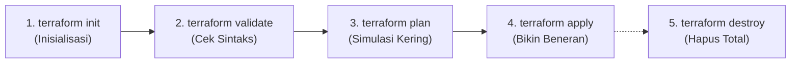

# ☁️ Terraform - Modul 01: Perintah Inti & Alur Kerja (IaC To-The-Point)

Cheatsheet kilat 5 perintah wajib Terraform untuk membuat, mengubah, dan menghapus infrastruktur cloud / cluster Kubernetes.

---

## ⚡ Alur 5 Perintah Wajib Terraform



---

### 1. `terraform init`
- **Fungsinya**: Inisialisasi folder project.
- **Apa yang dilakukan**: Men-download plugin binary provider yang dipakai (misal AWS, Google Cloud, atau Kubernetes) ke folder lokal `.terraform/`.
- **Kapan dipanggil**: Wajib pertama kali saat baru membuat project atau saat menambah provider baru.
```bash
terraform init
```

---

### 2. `terraform validate`
- **Fungsinya**: Memeriksa apakah konfigurasi syntax file `.tf` kita sudah benar atau ada yang typo/salah format sebelum dijalankan.
- **Apa yang dilakukan**: Validasi murni di lokal tanpa menyentuh server cloud nyata.
```bash
terraform validate
```

---

### 3. `terraform plan`
- **Fungsinya**: Simulasi kering untuk melihat: *"Kira-kira apa saja yang bakal dibuat, diubah, atau dihapus?"*.
- **Tanda yang perlu diperhatikan**:
  - `+ create`: Resource baru bakal dibuat.
  - `~ update in-place`: Resource yang ada bakal diubah isinya.
  - `- destroy`: Resource lama bakal dihapus.
```bash
terraform plan
```

---

### 4. `terraform apply`
- **Fungsinya**: Eksekusi beneran ke cloud atau cluster Kubernetes.
- **Otomatisasi**: Gunakan flag `-auto-approve` jika dijalankan di script CI/CD agar tidak ditanya ketik `yes`:
```bash
# Tanya konfirmasi dulu:
terraform apply

# Langsung eksekusi tanpa tanya:
terraform apply -auto-approve
```

---

### 5. `terraform destroy`
- **Fungsinya**: Menghapus dan membongkar semua resource yang sebelumnya berhasil di-apply (misal selesai testing agar tidak kena tagihan biaya cloud terus menerus).
```bash
# Menghapus seluruh infrastruktur:
terraform destroy

# Auto konfirmasi:
terraform destroy -auto-approve
```

---

## 📌 Catatan Penting File `terraform.tfstate`
File `terraform.tfstate` adalah database otak Terraform yang menyimpan kondisi infrastruktur nyata kamu saat ini.
- **JANGAN PERNAH** mengedit atau menghapus file ini secara manual!
- Di proyek tim, simpan file ini di remote backend (seperti AWS S3 atau Google Cloud Storage), bukan di git lokal.
