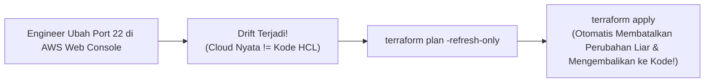

# ☁️ Terraform - Modul 06: Import Deklaratif, Drift Detection & Lifecycle Rules

Di modul penutup Terraform ini, kita akan membahas teknik enterprise: **mengadopsi infrastruktur lama yang dibuat manual via konsol web (*Importing*)**, **mendeteksi perubahan liar (*Configuration Drift*)**, dan memasang **pengaman anti-kehancuran data (*Lifecycle Rules*)**.

---

## 1. Mengimpor Infrastruktur Lama: Blok `import` (Terraform 1.5+)

Sebelum Terraform 1.5, mengimpor resource yang sudah terlanjur dibuat manual di AWS/GCP Console sangat menyakitkan: kamu harus menulis HCL kosong, menjalankan perintah CLI imperatif `terraform import`, lalu mencocokkan argumen satu per satu.

Sejak **Terraform 1.5+**, proses import dilakukan secara **Deklaratif**:

### Langkah 1: Tulis Blok `import`
```hcl
# Tentukan target resource dan ID fisik aslinya di Cloud:
import {
  to = aws_s3_bucket.bucket_lama
  id = "perusahaan-arsip-dokumen-lama"
}
```

### Langkah 2: Biarkan Terraform Menulis Kode HCL-nya Otomatis!
Jalankan flag `-generate-config-out`:
```bash
terraform plan -generate-config-out=generated_resources.tf
```
Terraform akan membaca API cloud dan **secara ajaib membuatkan file `generated_resources.tf` berisi seluruh konfigurasi HCL bucket tersebut secara sempurna**!

### Langkah 3: Eksekusi Import ke State
```bash
terraform apply
```
Resource manual kini resmi 100% dikelola oleh Terraform!

---

## 2. Configuration Drift & Deteksi Perubahan Liar

**Configuration Drift** terjadi ketika ada engineer nakal yang mengubah aturan Security Group atau menaikkan ukuran VM **langsung dari Web Console AWS/GCP**, sehingga kondisi nyata cloud berbeda dengan apa yang tercatat di kode Terraform.



### Cara Mendeteksi Drift Tanpa Mengubah Apa Pun:
```bash
terraform plan -refresh-only
```
Terraform akan memindai cloud dan melaporkan:
*"Terdapat perbedaan: Security Group memiliki aturan port 22 tambahan yang tidak terdaftar di kode HCL."*

### Menetralkan Drift:
Cukup jalankan `terraform apply`, dan Terraform akan **secara otomatis menghapus perubahan liar tersebut**, mengembalikan infrastruktur cloud agar patuh 100% pada kode HCL!

---

## 3. Aturan Pengaman: Blok `lifecycle`

Blok `lifecycle` mengontrol bagaimana Terraform memperlakukan siklus hidup resource:

```hcl
resource "google_sql_database_instance" "production_db" {
  name             = "master-db-production"
  database_version = "POSTGRES_16"
  region           = "asia-southeast2"

  settings {
    tier = "db-custom-8-32768"
  }

  lifecycle {
    # 1. PENGAMAN MUTLAK: Mencegah 'terraform destroy' menghapus database produksi!
    prevent_destroy = true

    # 2. ZERO DOWNTIME REPLACEMENT:
    # Jika resource terpaksa diganti, buat resource BARU terlebih dahulu,
    # baru setelah itu hancurkan resource lama:
    create_before_destroy = true

    # 3. Abaikan perubahan manual pada field tertentu (misal: tags otomatis dari AWS AutoScaling):
    ignore_changes = [
      settings[0].user_labels["last_scaled_time"]
    ]
  }
}
```

> [!CAUTION]
> **Penyelamat Karir**: Selalu pasang `prevent_destroy = true` pada semua database produksi, bucket penyimpanan data, dan VPC utama. Jika ada rekan kerja yang tidak sengaja menjalankan `terraform destroy`, Terraform akan **menolak eksekusi seketika**!
