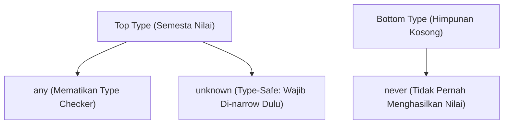

# 🔷 TypeScript - Modul 01: Basic Types, Type Inference & any vs unknown vs never

TypeScript adalah *superset* bertipe statis dari JavaScript yang dikembangkan oleh Anders Hejlsberg di Microsoft. Semua kode JavaScript yang valid adalah kode TypeScript yang valid, namun TypeScript menambahkan **Type Checker canggih yang menghapus 80% bug runtime saat kamu mengetik kode**.

---

## 1. Tipe Primitif & Type Inference Cerdas

Kompilator TypeScript memiliki algoritma inferensi tipe yang sangat pintar. Jangan menulis tipe secara eksplisit jika compiler sudah bisa menebaknya dengan benar:

```typescript
// 1. Type Inference (Otomatis tertebak, bersih tanpa clutter):
let nama = "Eka Developer"; // di-infer sebagai type 'string'
let umur = 28;              // di-infer sebagai type 'number'
let isAktif = true;         // di-infer sebagai type 'boolean'

// nama = 100; // COMPILE ERROR: Type 'number' is not assignable to type 'string'

// 2. Explicit Annotation (Hanya gunakan saat inisialisasi tertunda atau ambigu):
let saldo: number;
saldo = 500000;

// 3. Array & Tuple
let tags: string[] = ["react", "typescript", "astro"];
let tupleResponse: [number, string] = [200, "OK"]; // Fixed length & ordered types
```

---

## 2. Perang Tiga Serangkai: `any` vs `unknown` vs `never`

Memahami perbedaan ketiga tipe khusus ini adalah pembeda utama antara developer pemula dan master TypeScript:



| Tipe | Type Safety | Kapan Digunakan? | Perilaku Operasi |
|---|:---:|---|---|
| **`any`** | ❌ **Nol (Bahaya)** | Migrasi legacy JS darurat | Bebas memanggil method apa saja (`x.foo()`), tidak dicek oleh compiler. Rawan crash runtime! |
| **`unknown`**| ✅ **Maksimal** | Input eksternal (API response, JSON parse) | **Dilarang melakukan operasi apa pun** sebelum kamu membuktikan tipenya via Type Guard (`typeof`, `instanceof`). |
| **`never`** | ✅ **Maksimal** | Fungsi yang melempar error, infinite loop, atau exhaustive check | Menandakan bahwa nilai ini **secara matematis mustahil terjadi**. |

### Praktik Terbaik: Ganti `any` dengan `unknown`:
```typescript
// BAHAYA: Menggunakan any meloloskan bug ke produksi
function prosesAny(data: any) {
    data.toUpperCase(); // Tidak ada error saat kompilasi! Tapi crash jika data angka!
}

// AMAN: Menggunakan unknown memaksa validasi tipe
function prosesUnknown(data: unknown) {
    // data.toUpperCase(); // COMPILE ERROR: 'data' is of type 'unknown'

    // Wajib narrowing terlebih dahulu:
    if (typeof data === "string") {
        console.log(data.toUpperCase()); // AMAN & VALID! Di-promote jadi string
    }
}
```

---

## 3. Tipe `never` untuk Exhaustive Type Checking

Tipe `never` sangat berguna untuk memastikan semua cabang enum atau discriminated union telah ditangani:

```typescript
type Status = "PENDING" | "PAID" | "EXPIRED";

function renderBadge(s: Status): string {
    switch (s) {
        case "PENDING":
            return "Menunggu Pembayaran";
        case "PAID":
            return "Lunas";
        case "EXPIRED":
            return "Kadaluarsa";
        default:
            // JIKA KAMU MENAMBAHKAN STATUS BARU (misal: "REFUND") KE 'Status',
            // Baris ini akan otomatis ERROR saat kompilasi!
            const _exhaustiveCheck: never = s;
            return _exhaustiveCheck;
    }
}
```

---

## 4. `as const` Assertions (Literal Types & Deep Readonly)

Keyword `as const` menginstruksikan compiler untuk mengunci tipe data ke nilai literalnya secara mendalam (*deeply readonly*):

```typescript
// Tanpa 'as const': di-infer sebagai { host: string, port: number }
const configBiasa = {
    host: "localhost",
    port: 8080,
};
configBiasa.port = 9000; // Boleh diubah

// Dengan 'as const': di-infer sebagai { readonly host: "localhost", readonly port: 8080 }
const configKetat = {
    host: "localhost",
    port: 8080,
} as const;

// configKetat.port = 9000; // COMPILE ERROR: Cannot assign to 'port' because it is a read-only property

// Ekstrak Union Tipe dari as const array:
const METHOD = ["GET", "POST", "PUT", "DELETE"] as const;
type HttpMethod = typeof METHOD[number]; // "GET" | "POST" | "PUT" | "DELETE"
```

---

## 5. Type Assertion (`as`) vs Type Casting Sebenarnya

> [!WARNING]
> Type assertion di TypeScript (`data as string`) **BUKANLAH konversi data saat runtime**.
> Kata kunci `as` hanyalah cara memberitahu compiler: *"Percayalah padaku, aku lebih tahu daripada kamu"*. Jika nilai aslinya di memori RAM adalah integer, kode tidak akan mengubahnya menjadi teks!
