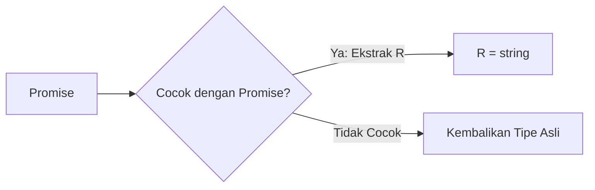

# 🔷 TypeScript - Modul 04: Conditional Types, Distributive Unions & Keyword infer

Sistem tipe data TypeScript bersifat *Turing-Complete*. **Conditional Types** dan kata kunci **`infer`** adalah fondasi komputasi logika tingkat tinggi yang memungkinkan tipe data bereaksi dan berubah bentuk secara dinamis berdasarkan input yang diterimanya.

---

## 1. Sintaks Dasar Conditional Types

Conditional types memiliki sintaks ternary operator yang persis seperti JavaScript, namun dievaluasi murni saat masa kompilasi:

```typescript
// Bentuk Umum: T extends U ? Benar : Salah
type IsString<T> = T extends string ? "Ya, ini teks" : "Bukan teks";

type A = IsString<"halo">; // "Ya, ini teks"
type B = IsString<12345>;  // "Bukan teks"
type C = IsString<boolean>; // "Bukan teks"
```

---

## 2. Sifat Distributif pada Union Types (*Distributive Conditional Types*)

Ketika tipe conditional diberikan sebuah **Union Type** (`A | B`), TypeScript secara otomatis **mendistribusikan evaluasi ke setiap anggota union satu per satu**:

```typescript
type BungkusArray<T> = T extends any ? T[] : never;

// Evaluasi didistribusikan:
// BungkusArray<string | number>
// => (string extends any ? string[] : never) | (number extends any ? number[] : never)
// => string[] | number[]
type HasilUnion = BungkusArray<string | number>; // string[] | number[]
```

> [!TIP]
> **Cara Mematikan Sifat Distributif**:
> Jika kamu ingin union diperlakukan sebagai satu kesatuan utuh (misal menghasilkan `(string | number)[]`), bungkus kedua sisi dengan tanda kurung siku `[T]`:
> ```typescript
> type BungkusTupleUtuh<T> = [T] extends [any] ? T[] : never;
> type HasilUtuh = BungkusTupleUtuh<string | number>; // (string | number)[]
> ```

---

## 3. Kata Kunci `infer`: Pattern Matching di Level Tipe

Kata kunci `infer` adalah mekanisme sakti untuk **mendeklarasikan variabel tipe baru di tengah ekspresi conditional** dan membiarkan compiler mengekstrak tipe tersebut secara otomatis dari polanya:



### Kasus 1: Ekstrak Tipe Elemen dari Dalam Array
```typescript
type EkstrakElemen<T> = T extends (infer E)[] ? E : T;

type Angka = EkstrakElemen<number[]>; // number
type Teks = EkstrakElemen<string[]>;  // string
type BukanArray = EkstrakElemen<boolean>; // boolean (karena tidak cocok pola array)
```

### Kasus 2: Implementasi Sendiri `MyAwaited<T>` (Rekursif)
Membongkar Promise berulang kali hingga menemukan tipe data aslinya:
```typescript
type MyAwaited<T> = T extends Promise<infer Inner>
    ? MyAwaited<Inner> // Rekursif jika Inner masih berupa Promise
    : T;

type ResponseData = MyAwaited<Promise<Promise<{ id: number; nama: string }>>>;
// ResponseData = { id: number; nama: string }
```

### Kasus 3: Ekstrak Argumen Pertama Suatu Fungsi
```typescript
type AmbilArgumenPertama<F> = F extends (arg1: infer FirstArg, ...rest: any[]) => any
    ? FirstArg
    : never;

function kirimEmail(target: string, pesan: string, prioritas: number): boolean {
    return true;
}

type TargetType = AmbilArgumenPertama<typeof kirimEmail>; // string!
```
