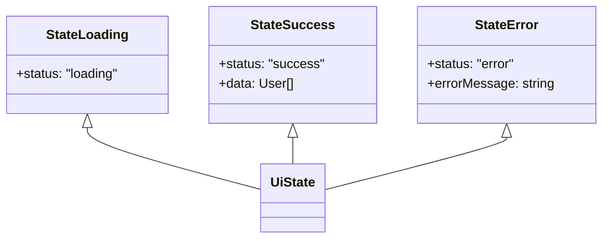

# 🔷 TypeScript - Modul 06: Type Narrowing, Custom Type Guards & Discriminated Unions

Kompilator TypeScript dilengkapi dengan mesin **Control Flow Analysis (CFA)** yang cerdas. Saat membaca kode kondisional (`if`, `switch`), compiler dapat mempersempit (*narrowing*) tipe data yang luas menjadi tipe yang jauh lebih spesifik dan aman.

---

## 1. Mekanisme Type Narrowing Bawaan

```typescript
function prosesInput(val: string | number | Date | { [key: string]: any }) {
    // 1. Narrowing dengan 'typeof' (Hanya untuk tipe primitif)
    if (typeof val === "string") {
        return val.toUpperCase(); // Di-narrow menjadi type 'string'
    }

    if (typeof val === "number") {
        return val.toFixed(2); // Di-narrow menjadi type 'number'
    }

    // 2. Narrowing dengan 'instanceof' (Untuk class dan objek instansiasi)
    if (val instanceof Date) {
        return val.toISOString(); // Di-narrow menjadi type 'Date'
    }

    // 3. Narrowing dengan operator 'in' (Mengecek keberadaan properti objek)
    if ("role" in val) {
        console.log("Objek memiliki field role!");
    }
}
```

---

## 2. User-Defined Type Guards (`val is Type`)

Ketika logika pengecekan objek rumit, operator bawaan tidak cukup. Kita bisa membuat fungsi validasi custom yang mengembalikan **Type Predicate** dengan sintaks `parameter is Tipe`:

```typescript
interface Mobil {
    jenis: "roda_empat";
    kemudikan(): void;
}

interface Perahu {
    jenis: "air";
    berlayar(): void;
}

type Kendaraan = Mobil | Perahu;

// CUSTOM TYPE GUARD: Mengembalikan type predicate 'k is Mobil'
function isMobil(k: Kendaraan): k is Mobil {
    return (k as Mobil).kemudikan !== undefined;
}

function gunakanKendaraan(k: Kendaraan) {
    if (isMobil(k)) {
        // Compiler tahu 100% bahwa di dalam blok ini 'k' adalah Mobil!
        k.kemudikan();
    } else {
        // Otomatis di-narrow menjadi Perahu!
        k.berlayar();
    }
}
```

---

## 3. Assertion Functions (`asserts condition`)

Untuk validasi otentikasi atau guard clause yang melempar exception jika kondisi tidak terpenuhi, gunakan kata kunci `asserts`:

```typescript
interface AkunLogin {
    id: string;
    role: "admin" | "user";
}

// Fungsi assertion: jika tidak melempar error, compiler menjamin user adalah Admin!
function assertAdmin(user: AkunLogin): asserts user is AkunLogin & { role: "admin" } {
    if (user.role !== "admin") {
        throw new Error("Akses ditolak: Hanya admin yang diizinkan!");
    }
}

function hapusSemuaDatabase(user: AkunLogin) {
    assertAdmin(user);
    // Di baris ini ke bawah, user.role otomatis bernilai literal "admin"!
    console.log("Admin terverifikasi:", user.id);
}
```

---

## 4. Discriminated Unions (Tagged Unions): Pola Terpenting TypeScript

**Discriminated Union** adalah pola pemodelan state terbaik di TypeScript. Ciri utamanya: setiap tipe dalam union memiliki **satu properti pembeda (*discriminant*) dengan nilai literal yang unik**:



```typescript
type ApiResponse =
    | { status: "loading" }
    | { status: "success"; data: string[] }
    | { status: "error"; errorMessage: string; errorCode: number };

function renderUI(res: ApiResponse) {
    switch (res.status) {
        case "loading":
            // res.data TIDAK BISA diakses di sini (Mencegah bug UI kosong!)
            return "Menampilkan spinner loading...";

        case "success":
            // res.data DIJAMIN ADA dan bertipe string[]!
            return `Data berhasil diambil: ${res.data.join(", ")}`;

        case "error":
            // res.errorMessage dan errorCode DIJAMIN ADA!
            return `Error (${res.errorCode}): ${res.errorMessage}`;

        default:
            const _unhandled: never = res;
            return _unhandled;
    }
}
```

> [!TIP]
> **Mengapa ini superior?** Dibandingkan membuat satu objek gembul dengan banyak flag opsional (`{ isLoading?: boolean, data?: any, error?: string }`), Discriminated Union **meniadakan status yang mustahil secara logika** (*make impossible states unrepresentable*). Mustahil ada kondisi `isLoading: true` sekaligus `error: "Gagal"` di UI!
