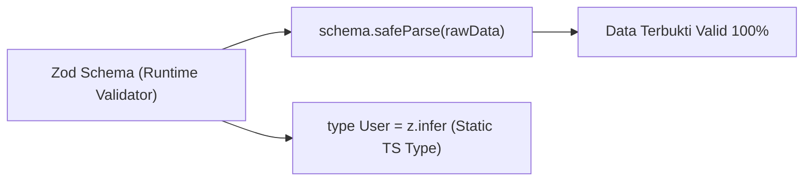

# 🔷 TypeScript - Modul 08: Runtime Type Validation & Schema Parsing dengan Zod

Mitos terbesar developer pemula: *"Karena aplikasi saya ditulis dengan TypeScript, saya bebas dari bug tipe data saat runtime"*. **SALAH BESAR!**

TypeScript menderita **Type Erasure**: semua kode tipe data (`interface`, `type`, generics) dihapus 100% saat dikompilasi ke JavaScript. Di batas jaringan (*API boundary*, response fetch, input form pengguna, file JSON), **TypeScript buta total terhadap data nyata yang masuk**.

---

## 1. Masalah Fatal: "Type Drift" & Ilusi Keamanan

Perhatikan kode berbahaya berikut:

```typescript
interface UserResponse {
    id: number;
    email: string;
}

async function getUser(): Promise<UserResponse> {
    const res = await fetch("https://api.backend.com/users/1");
    // BAHAYA: Type assertion 'as UserResponse' adalah KEBOHONGAN!
    // Compiler percaya data valid, padahal jika backend mengembalikan { error: "Unauthenticated" },
    // aplikasi akan crash fatal saat mengakses data.email.toLowerCase()!
    return res.json() as Promise<UserResponse>;
}
```

---

## 2. Solusi Industri: Schema-First Development dengan Zod

**Zod** adalah pustaka validasi skema berbasis TypeScript yang memberikan **keamanan tipe runtime nyata** sekaligus **otomatis menghasilkan tipe TypeScript statis** tanpa perlu menduplikasi deklarasi interface!



### Menginstal Zod:
```bash
npm install zod
```

---

## 3. Mendefinisikan Skema & Inferensi Tipe Otomatis (`z.infer`)

```typescript
import { z } from "zod";

// 1. Skema Validasi Runtime (Hidup di JavaScript hasil kompilasi):
export const UserSchema = z.object({
    id: z.string().uuid("Format UUID tidak valid"),
    nama: z.string().min(3, "Nama minimal 3 karakter"),
    email: z.string().email("Format email salah"),
    umur: z.number().int().positive().optional(),
    role: z.enum(["admin", "editor", "viewer"]).default("viewer"),
});

// 2. OTOMATIS MENGHASILKAN TIPE TYPESCRIPT STATIS (Satu sumber kebenaran):
export type User = z.infer<typeof UserSchema>;

// Tipe User di-infer sempurna sebagai:
// {
//     id: string;
//     nama: string;
//     email: string;
//     umur?: number | undefined;
//     role: "admin" | "editor" | "viewer";
// }
```

---

## 4. Pola Aman: `safeParse` vs `parse`

- **`schema.parse(data)`**: Melempar exception `ZodError` jika data tidak valid (bagus untuk crash-early saat startup).
- **`schema.safeParse(data)`**: Mengembalikan **Discriminated Union** `{ success: true, data }` atau `{ success: false, error }` tanpa melempar error:

```typescript
async function fetchUserAman(id: string): Promise<User | null> {
    const response = await fetch(`/api/users/${id}`);
    const rawJson = await response.json();

    // Validasi data nyata dari jaringan:
    const hasil = UserSchema.safeParse(rawJson);

    if (!hasil.success) {
        console.error("Format data API dari backend rusak atau berubah!", hasil.error.format());
        return null; // Menyelamatkan aplikasi dari white screen of death
    }

    // hasil.data DIJAMIN 100% VALID dan type-safe!
    return hasil.data;
}
```

---

## 5. Pola Produksi Wajib: Validasi Environment Variables (`env.ts`)

Mencegah aplikasi startup jika variabel `.env` penting kelupaan disetel di Kubernetes atau Vercel:

```typescript
// src/env.ts
import { z } from "zod";

const envSchema = z.object({
    NODE_ENV: z.enum(["development", "test", "production"]).default("development"),
    PORT: z.coerce.number().default(3000), // z.coerce otomatis mengubah string "3000" jadi number!
    DATABASE_URL: z.string().url("DATABASE_URL wajib berupa URL valid"),
    JWT_SECRET: z.string().min(32, "JWT_SECRET minimal 32 karakter demi keamanan"),
});

// Validasi process.env saat aplikasi pertama kali boot
const parsedEnv = envSchema.safeParse(process.env);

if (!parsedEnv.success) {
    console.error("❌ Konfigurasi Environment Variables Gagal:");
    console.error(JSON.stringify(parsedEnv.error.format(), null, 2));
    process.exit(1); // Matikan aplikasi seketika jika env rusak!
}

export const env = parsedEnv.data;
```
